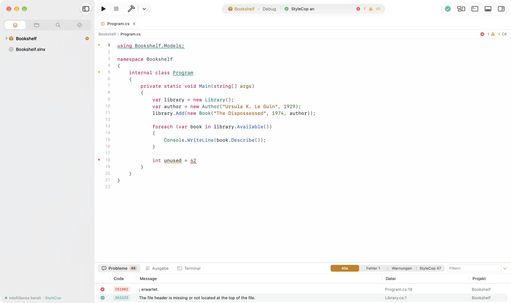
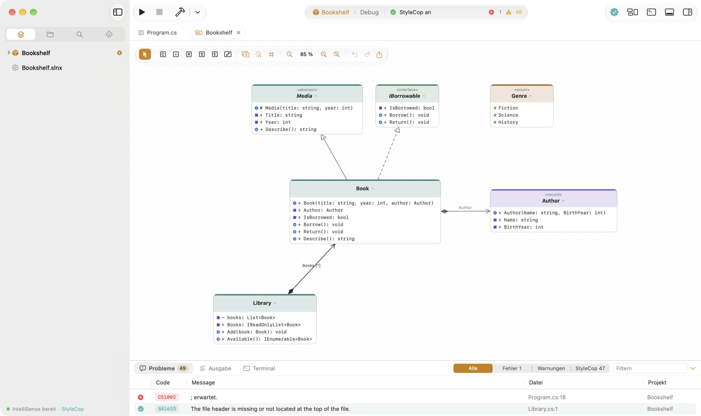

# VsLike

**Eine native C#-IDE für macOS und Linux.** Editor mit IntelliSense, Build, Tests, Debugger, StyleCop und ein Klassendiagramm,
das direkt in den Code schreibt. Die macOS-Oberfläche ist in Swift geschrieben (SwiftUI und AppKit), die Linux-Oberfläche mit Avalonia; die C#-Analyse
übernimmt auf beiden Roslyn in einem Hintergrundprozess. Keine Telemetrie, Lizenz MIT.



## Funktionen

- **Editor und IntelliSense:** sofortiges Highlighting plus semantische Farben von Roslyn, Vervollständigung mit
  Dokumentation, Parameterhilfe, Hover-Infos, Fehler live beim Tippen, Gehe zu Definition (F12), Verweise suchen
  (⇧F12), Umbenennen (F2), Formatieren (⌥⇧F), Snippets wie `prop` oder `ctor`.
- **Quick-Actions (⇧⌘.):** Korrekturen wie fehlende `using`-Direktiven oder fehlende Methoden, Refactorings und
  „Alle beheben“ für Dokument oder Projekt.
- **StyleCop:** pro Solution in der Toolbar schaltbar, respektiert `.editorconfig` und `stylecop.json`, verändert die
  `.csproj` nicht.
- **Build, Tests, Debugger:** Bauen (⌘B), Test-Explorer (⌘U), Debuggen mit netcoredbg inklusive bedingter
  Haltepunkte, Variablen, Überwachen und Aufrufliste. Programme laufen im eingebauten Terminal und können Eingaben lesen.
- **Projekte:** neue Solutions und Projekte aus Vorlagen, NuGet-Pakete, Projekteigenschaften und -verweise.
- **Navigation:** Schnell öffnen (⌘P), Befehlspalette (⇧⌘P), Suche in allen Dateien (⇧⌘F).

Die Oberfläche gibt es auf Deutsch und Englisch.

### Klassendiagramm

Das Klassendiagramm (⇧⌘D) arbeitet in beide Richtungen: Typen, Mitglieder und Vererbung im Diagramm ändern den Code
über Roslyn, Codeänderungen erscheinen sofort im Diagramm. Das Layout liegt im `.cd`-Format neben dem Projekt, Undo
umfasst Diagramm und Code gemeinsam, Export als SVG oder PNG.



## Installation

VsLike gibt es für macOS und für Linux (Fedora, Arch). Die Linux-Anleitung steht [weiter unten](#linux-fedora-arch).

### macOS

Voraussetzungen: Mac mit Apple Silicon, macOS 26 oder neuer und ein .NET SDK ab Version 10
(`brew install --cask dotnet-sdk`). Der Startbildschirm zeigt an, ob ein passendes SDK gefunden wurde.

```sh
brew install --cask LaJuMiRa/tap/vslike
```

VsLike ist ad-hoc signiert, aber nicht von Apple notarisiert, deshalb blockiert macOS den ersten Start. Erlaube ihn
einmal unter *Systemeinstellungen › Datenschutz & Sicherheit › „Dennoch öffnen“* oder entferne die Quarantäne:

```sh
xattr -dr com.apple.quarantine /Applications/VsLike.app
```

### Linux (Fedora, Arch)

Voraussetzungen: x86_64 oder arm64 (Arch-Paket nur x86_64), ein Desktop mit X11 (die App nutzt die X11-Bibliotheken) und ein .NET SDK ab
Version 10. Fedora- und Arch-Pakete ziehen das SDK automatisch nach. Die Pakete liegen bei den
[GitHub-Releases](../../releases) mit dem Tag `linux-vX.Y.Z` (Release „VsLike for Linux“), getrennt von den macOS-Releases.

**Fedora** (RPM für x86_64 und aarch64, Installation und Start getestet auf Fedora 43 arm64):

```sh
sudo dnf install ./vslike-<version>-1.fc43.x86_64.rpm      # auf arm64: ...aarch64.rpm
```

**Arch Linux** (Paket `vslike-bin`, x86_64):

```sh
sudo pacman -U vslike-bin-<version>-1-x86_64.pkg.tar.zst
```

**Andere Distributionen** (Tarball für x64 und arm64; das .NET SDK 10 oder neuer, `fontconfig` und die X11-Bibliotheken
`libX11`, `libICE`, `libSM`, `libXcursor`, `libXi`, `libXrandr` müssen vorhanden sein):

```sh
sha256sum -c vslike-<version>-linux-x64.tar.gz.sha256
sudo tar -xzf vslike-<version>-linux-x64.tar.gz -C /
```

Das Archiv enthält einen fertigen `usr/`-Baum (Starter `/usr/bin/vslike`, App in `/usr/lib/vslike`). Der Pfad ist im Starter
fest eingetragen, das Archiv muss deshalb nach `/` entpackt werden. Zum Entfernen die Dateien unter `/usr/bin/vslike`,
`/usr/lib/vslike` und `/usr/share/{applications,icons,mime,licenses}` mit dem Namen `vslike` löschen.

Gestartet wird über den Anwendungsmenü-Eintrag „VsLike“ oder im Terminal mit `vslike [Solution, Projekt, Ordner oder Datei]`.
Der Startbildschirm zeigt an, ob ein passendes SDK gefunden wurde. Einstellungen liegen unter `~/.config/vslike`, der
Zwischenspeicher unter `~/.cache/vslike`. Tastenkürzel: ⌘ wird zu Strg, ⌥ zu Alt, ⌃⌘R zu Strg+Alt+R.

Die Pakete sind nicht signiert. Deinstallieren: `sudo dnf remove vslike` bzw. `sudo pacman -R vslike-bin`.

## Aus dem Quellcode bauen

Nötig sind Xcode 26 (oder die Command Line Tools mit Swift 6.2) und das .NET SDK 10.

```sh
./build.sh      # baut build/VsLike.app
./release.sh    # führt alle Tests aus, baut und packt dist/VsLike-<version>-arm64.zip
```

| Ordner | Inhalt |
|---|---|
| `Sources/VsLike` | macOS-App: Fenster, Editor, Panels, Terminal, Klassendiagramm |
| `Sources/VsLikeKit` | Swift ohne AppKit: Engine-Client, dotnet-CLI, Solution-Dateien, Debugger-Client (DAP), Lexer |
| `engine/` | C#-Analyseprozess mit Roslyn, StyleCop und Diagramm-Writer hinter JSON-RPC |
| `Tests/` | Swift-Tests (`swift test`); Engine-Tests mit `dotnet test engine/VsLike.Engine.slnx` |

Release-Schritte stehen in [`RELEASING.md`](RELEASING.md), Architekturentscheidungen in
[`docs/DECISIONS.md`](docs/DECISIONS.md), Änderungen in [`CHANGELOG.md`](CHANGELOG.md).

## Lizenz

[MIT](LICENSE)
